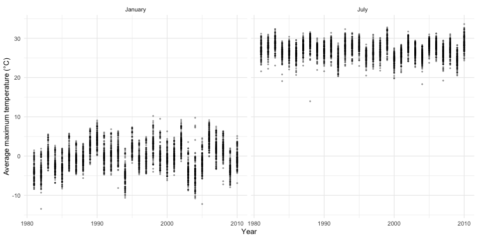
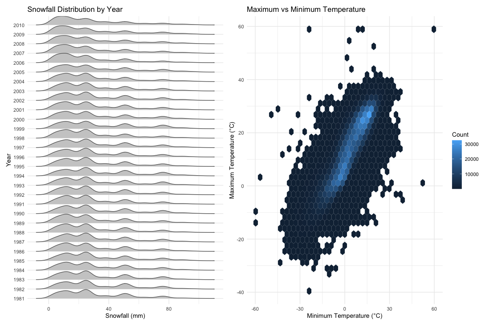

P8105 Homework 3
================
Chengshun Zhao
2026-10-14

\##Problem 1

``` r
library(tidyverse)
```

    ## ── Attaching core tidyverse packages ──────────────────────── tidyverse 2.0.0 ──
    ## ✔ dplyr     1.2.1     ✔ readr     2.2.0
    ## ✔ forcats   1.0.1     ✔ stringr   1.6.0
    ## ✔ ggplot2   4.0.3     ✔ tibble    3.3.1
    ## ✔ lubridate 1.9.5     ✔ tidyr     1.3.2
    ## ✔ purrr     1.2.2     
    ## ── Conflicts ────────────────────────────────────────── tidyverse_conflicts() ──
    ## ✖ dplyr::filter() masks stats::filter()
    ## ✖ dplyr::lag()    masks stats::lag()
    ## ℹ Use the conflicted package (<http://conflicted.r-lib.org/>) to force all conflicts to become errors

``` r
library(p8105.datasets)

data("ny_noaa")

dim(ny_noaa)
```

    ## [1] 2595176       7

``` r
glimpse(ny_noaa)
```

    ## Rows: 2,595,176
    ## Columns: 7
    ## $ id   <chr> "US1NYAB0001", "US1NYAB0001", "US1NYAB0001", "US1NYAB0001", "US1N…
    ## $ date <date> 2007-11-01, 2007-11-02, 2007-11-03, 2007-11-04, 2007-11-05, 2007…
    ## $ prcp <int> NA, NA, NA, NA, NA, NA, NA, NA, NA, NA, NA, NA, NA, NA, NA, NA, 3…
    ## $ snow <int> NA, NA, NA, NA, NA, NA, NA, NA, NA, NA, NA, NA, NA, NA, NA, NA, 3…
    ## $ snwd <int> NA, NA, NA, NA, NA, NA, NA, NA, NA, NA, NA, NA, NA, NA, NA, NA, 0…
    ## $ tmax <chr> NA, NA, NA, NA, NA, NA, NA, NA, NA, NA, NA, NA, NA, NA, NA, NA, N…
    ## $ tmin <chr> NA, NA, NA, NA, NA, NA, NA, NA, NA, NA, NA, NA, NA, NA, NA, NA, N…

``` r
ny_noaa |>
  summarize(
    across(everything(), ~ sum(is.na(.)))
  )
```

    ## # A tibble: 1 × 7
    ##      id  date   prcp   snow   snwd    tmax    tmin
    ##   <int> <int>  <int>  <int>  <int>   <int>   <int>
    ## 1     0     0 145838 381221 591786 1134358 1134420

``` r
ny_noaa |>
  summarize(
    across(everything(), ~ round(mean(is.na(.)) * 100, 2))
  )
```

    ## # A tibble: 1 × 7
    ##      id  date  prcp  snow  snwd  tmax  tmin
    ##   <dbl> <dbl> <dbl> <dbl> <dbl> <dbl> <dbl>
    ## 1     0     0  5.62  14.7  22.8  43.7  43.7

The NY NOAA data set has 2,595,176 observations and 7 variables. The
variables are station ID, date, precipitation, snowfall, snow depth,
maximum temperature, and minimum temperature. Missing data are an
important issue in this data set. Both maximum and minimum temperatures
are missing 43.71% of the time. Snow depth is missing 22.80% of the
time. Snowfall is missing 14.69% of the time and precipitation is
missing 5.62% of the time. The variables station ID and date do not
contain any missing data.

\##Data Cleaning

``` r
noaa_clean = ny_noaa |>
  mutate(
    year = lubridate::year(date),
    month = lubridate::month(date),
    day = lubridate::day(date),
    tmax = as.numeric(tmax) / 10,
    tmin = as.numeric(tmin) / 10,
    prcp = prcp / 10
  )

glimpse(noaa_clean)
```

    ## Rows: 2,595,176
    ## Columns: 10
    ## $ id    <chr> "US1NYAB0001", "US1NYAB0001", "US1NYAB0001", "US1NYAB0001", "US1…
    ## $ date  <date> 2007-11-01, 2007-11-02, 2007-11-03, 2007-11-04, 2007-11-05, 200…
    ## $ prcp  <dbl> NA, NA, NA, NA, NA, NA, NA, NA, NA, NA, NA, NA, NA, NA, NA, NA, …
    ## $ snow  <int> NA, NA, NA, NA, NA, NA, NA, NA, NA, NA, NA, NA, NA, NA, NA, NA, …
    ## $ snwd  <int> NA, NA, NA, NA, NA, NA, NA, NA, NA, NA, NA, NA, NA, NA, NA, NA, …
    ## $ tmax  <dbl> NA, NA, NA, NA, NA, NA, NA, NA, NA, NA, NA, NA, NA, NA, NA, NA, …
    ## $ tmin  <dbl> NA, NA, NA, NA, NA, NA, NA, NA, NA, NA, NA, NA, NA, NA, NA, NA, …
    ## $ year  <dbl> 2007, 2007, 2007, 2007, 2007, 2007, 2007, 2007, 2007, 2007, 2007…
    ## $ month <dbl> 11, 11, 11, 11, 11, 11, 11, 11, 11, 11, 11, 11, 11, 11, 11, 11, …
    ## $ day   <int> 1, 2, 3, 4, 5, 6, 7, 8, 9, 10, 11, 12, 13, 14, 15, 16, 17, 18, 1…

``` r
noaa_clean |>
  count(snow, sort = TRUE) |>
  print(n = 10)
```

    ## # A tibble: 282 × 2
    ##     snow       n
    ##    <int>   <int>
    ##  1     0 2008508
    ##  2    NA  381221
    ##  3    25   31022
    ##  4    13   23095
    ##  5    51   18274
    ##  6    76   10173
    ##  7     8    9962
    ##  8     5    9748
    ##  9    38    9197
    ## 10     3    8790
    ## # ℹ 272 more rows

The most frequent snowfall value is 0 mm because most days have no
snowfall. There are many missing observations. Among positive snowfall
values, 25 mm, 13 mm, 51 mm, and 76 mm are common. Values of 1, 0.5, 2
and 3 inches correspond to these, respectively. This suggests that
snowfall was previously measured in inches and then converted to mm.

## Average Maximum Temperature in January and July

``` r
jan_jul = noaa_clean |>
  filter(month %in% c(1, 7)) |>
  group_by(id, year, month) |>
  summarize(
    mean_tmax = mean(tmax, na.rm = TRUE),
    .groups = "drop"
  ) |>
  filter(!is.nan(mean_tmax)) |>
  mutate(
    month = factor(
      month,
      levels = c(1, 7),
      labels = c("January", "July")
    )
  )

ggplot(jan_jul, aes(x = year, y = mean_tmax)) +
  geom_point(alpha = 0.3, size = 0.6) +
  facet_wrap(~ month) +
  labs(
    x = "Year",
    y = "Average maximum temperature (°C)"
  ) +
  theme_minimal()
```

<!-- -->
The difference between January and July is very clear. From the plots it
shows January max temperatures are between -5°C and +5°C with
considerable variation. July temperatures range from 25°C to 30°C. In
January 1982 there was an outlier as it was unusually cold for the
month. July 1988 also has an outlier as it was relatively cool for the
month.

## Temperature and Snowfall

``` r
library(ggridges)
library(patchwork)

snow_plot = noaa_clean |>
  filter(!is.na(snow), snow > 0, snow < 100) |>
  mutate(year = factor(year)) |>
  ggplot(aes(x = snow, y = year)) +
  geom_density_ridges(
    scale = 1,
    fill = "gray80",
    color = "gray40",
    bandwidth = 3.76
  ) +
  labs(
    title = "Snowfall Distribution by Year",
    x = "Snowfall (mm)",
    y = "Year"
  ) +
  theme_minimal()

temp_plot = noaa_clean |>
  filter(!is.na(tmax), !is.na(tmin)) |>
  ggplot(aes(x = tmin, y = tmax)) +
  geom_hex(bins = 40) +
  labs(
    title = "Maximum vs Minimum Temperature",
    x = "Minimum Temperature (°C)",
    y = "Maximum Temperature (°C)",
    fill = "Count"
  ) +
  theme_minimal()

snow_plot + temp_plot
```

<!-- -->
Snowfall distributions tend to be similar from year to year. Smaller
snowfall amounts tend to occur more frequently and larger snowfall
amounts tend to occur less frequently. There appear to be multiple peaks
in the distributions, possibly due to the fact that originally snowfall
amounts were measured in inches and then converted to the metric system.

The hexbin plot of minimum and maximum temperatures shows a positive
correlation. Most of the data is in the mid range of temperatures, and
extreme high and low temperatures may be outliers or represent data
quality issues.
